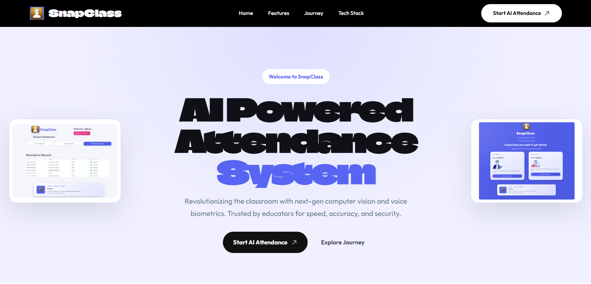

# SnapClass

SnapClass is an AI-powered classroom attendance platform designed to simplify attendance tracking for teachers and students through modern biometric and digital workflows. The project combines computer vision, voice recognition, QR-based enrollment, and a clean dashboard experience to replace error-prone manual attendance systems.

This repository contains the front-end / landing page for the SnapClass ecosystem, along with the Flask application that serves the product site and showcases the platform's capabilities.

## Live Project

**Visit the deployed SnapClass landing page:** [sc-landing-page-cyan.vercel.app](https://sc-landing-page-cyan.vercel.app/)

This is the primary public link for viewing the project. From the landing page, select **Start AI Attendance** to open the SnapClass attendance application:
[snapclass-only.streamlit.app](https://snapclass-only.streamlit.app/).

> **Core application:** This repository contains the SnapClass landing page only. The core AI attendance logic and application are maintained in the separate [Snap-Class repository](https://github.com/Ashavmodhgill/Snap-Class). The **Start AI Attendance** link takes visitors from this landing page to the deployed attendance application.

## Project Overview

Education institutions often still rely on manual attendance processes that are slow, inaccurate, and difficult to audit. SnapClass addresses this problem by automating attendance using:

- AI-based face recognition
- Voice recognition for attendance confirmation
- QR-based classroom or course registration
- Teacher-focused dashboard and management interface
- Digital attendance logs and reporting flow

The platform is positioned as a smart classroom solution that helps teachers reduce administrative burden and improve student engagement.

## Why SnapClass

Traditional attendance systems create several challenges:

- Time lost during roll call
- Inaccurate or manipulated attendance
- Difficulty tracking records across classes and subjects
- Manual paperwork and fragmented class management
- Poor visibility into student participation trends

SnapClass aims to solve these problems with a streamlined digital experience that is fast, scalable, and suitable for modern education environments.

## Key Features

### 1. AI Face Analysis
The system uses facial recognition technology to identify students from class photos or live captured frames. This allows attendance to be marked quickly and reduces errors from manual entry.

### 2. Sequential Voice Identification
Students can verify or confirm attendance using voice recognition. The platform is designed to compare a spoken response against stored voice embeddings to recognize identities in a structured, class-friendly workflow.

### 3. QR-Driven Enrollment
Course or classroom codes can generate unique QR-based sessions that simplify student registration and reduce the administrative overhead of adding students manually.

### 4. Teacher Dashboard
Teachers can manage subjects, view enrollment details, monitor attendance, and track classroom workflows through a centralized interface.

### 5. Attendance Records and Reporting
The product supports historical attendance tracking and reporting workflows, making it easier for educators to review patterns and maintain accountability.

### 6. Modern Product Presentation
This repository includes a polished landing page that communicates the value proposition of SnapClass to users and stakeholders.

## System Architecture

The current repository follows a lightweight architecture centered around Flask:

- Flask app serves the landing page and product website
- HTML templates render the UI
- CSS handles the visual styling and responsiveness
- Static image assets display the platform's flow, screenshots, and branding
- The separate [Snap-Class repository](https://github.com/Ashavmodhgill/Snap-Class) contains the core attendance application and AI logic

The deployed landing page is hosted on Vercel:

https://sc-landing-page-cyan.vercel.app/

The landing page's **Start AI Attendance** buttons link to the deployed attendance application:

https://snapclass-only.streamlit.app/

The landing page and AI attendance application are separate projects and deployments. Use the Vercel link to view this website, the Streamlit link to access the attendance experience, and the GitHub repository above to explore its core implementation.

## Tech Stack

### Front-End / Presentation
- HTML5
- CSS3
- JavaScript (embedded through page interactions and UI behavior)
- Jinja2 templates for Flask rendering

### Back-End
- Python
- Flask

### Supporting Tools
- Virtual environment for local development
- Static assets for product branding and interface previews

### Product / AI Components (as described in the UI)
- Face recognition / AI vision models
- Voice recognition / audio embeddings
- QR enrollment workflows
- Cloud storage services such as Supabase

## Project Structure

```text
SNAPCLASS-FRONTEND/
├── app.py
├── requirements.txt
├── README.md
├── __pycache__/
├── venv/
├── static/
│   ├── css/
│   │   └── styles.css
│   └── img/
│       ├── Snaplogo.png
│       ├── homepage.png
│       ├── qr-code.png
│       ├── student-face-registration.png
│       ├── teacher-attendance-record.png
│       ├── teacher-attendance.png
│       ├── teacher-login.png
│       ├── teacher-manage-subject.png
│       ├── voice-recognition.png
│       └── demo/
└── templates/
    └── index.html
```

## Application Details

### Flask App
The main entry point is `app.py` and it defines a single route:

- `/` -> renders the `index.html` template

The app uses Flask and runs locally on port `5002` by default.

### Landing Page
The template file `templates/index.html` contains:

- navigation bar
- hero section
- feature cards
- teacher journey workflow
- technology stack section
- CTA block for starting AI attendance
- footer

This page is designed to present SnapClass as a premium AI classroom solution.

## Setup and Installation

### Prerequisites

Before you start, make sure you have the following installed:

- Python 3.8+
- pip package manager
- Git
- A modern web browser

### 1. Clone the Repository

```bash
git clone <repository-url>
cd SNAPCLASS-FRONTEND
```

### 2. Create a Virtual Environment

```bash
python -m venv venv
```

On Windows:

```bash
venv\Scripts\activate
```

On macOS/Linux:

```bash
source venv/bin/activate
```

### 3. Install Dependencies

```bash
pip install -r requirements.txt
```

### 4. Run the Application

```bash
python app.py
```

The application will start locally and listen on:

```text
http://localhost:5002
```

### 5. Access the Website

Open a browser and go to:

```text
http://localhost:5002/
```

## Running in Production

The current app is configured for local development:

```python
app.run(debug=True, port=5002)
```

For production deployment, the app should be adjusted to:

- disable debug mode
- use a production WSGI server such as Gunicorn
- configure environment variables for deployment
- handle static file serving properly in a production environment
- secure any external integrations or secret credentials

## Development Notes

This is a front-end showcase project and not a full production backend system yet. It is ideal for:

- product presentations
- concept validation
- demo landing pages
- visualizing the SnapClass experience
- presenting the classroom AI workflow to stakeholders

The application currently focuses on a polished user experience rather than a full database-driven school management backend.

## Product Flow

A typical teacher/user journey is represented by the UI:

1. Open the landing page
2. Review product features and technology
3. Click “Start AI Attendance”
4. Continue to the deployed attendance application (core logic is in the [Snap-Class repository](https://github.com/Ashavmodhgill/Snap-Class))
5. Manage attendance using face recognition, voice confirmation, or QR enrollment
6. Review attendance records and classroom activity

## Use Cases

SnapClass can be used in scenarios such as:

- schools and colleges
- universities with large lecture halls
- hybrid and digital classrooms
- attendance automation for faculty
- student verification and participation monitoring

## Business Value

The platform aims to deliver:

- reduced attendance processing time
- improved record accuracy
- lower administrative overhead
- modernized classroom operations
- faster, more transparent educational workflows

## Security and Privacy Considerations

Even though this landing page is lightweight, a real deployment of an AI attendance system should consider:

- secure student data handling
- encrypted storage for biometric data
- privacy consent workflows
- role-based access control for teachers and administrators
- audit logs for attendance changes
- compliance with institutional and regional privacy regulations

## Future Roadmap

Potential improvements for the project include:

- database-backed attendance records
- teacher and student authentication
- analytics dashboard for participation trends
- admin controls for managing classes and subjects
- automated report exports (CSV/PDF)
- real-time classroom monitoring
- improved security and production deployment setup
- mobile-first improvements

## Contributing

Contributions are welcome if you want to improve the project. Typical areas include:

- UI enhancement
- backend development
- attendance logic integration
- accessibility improvements
- responsive design updates
- documentation refinement

To contribute:

```bash
git checkout -b feature/your-feature-name
# make your changes
git commit -m "Add your feature"
git push origin feature/your-feature-name
```

Then open a pull request and describe the change clearly.

## License

This project currently does not appear to include a formal license file. Before publishing or distributing it publicly, it is recommended to add an appropriate open-source license such as MIT or Apache 2.0, depending on your intended usage and distribution model.

## Author

Built with care for the SnapClass project by Ashavdeep.

## Contact

For questions, collaboration, or project support, reach out through the repository owner or maintainers associated with this project.

## Summary

SnapClass is a modern AI-powered attendance ecosystem designed to transform classroom management through computer vision, voice recognition, QR-based registration, and streamlined educator workflows. This repository provides the polished front-end and product showcase for the project and demonstrates the platform's vision from a user experience and branding perspective.

The project is an excellent foundation for a classroom technology product and can be extended into a larger full-stack attendance management solution.
